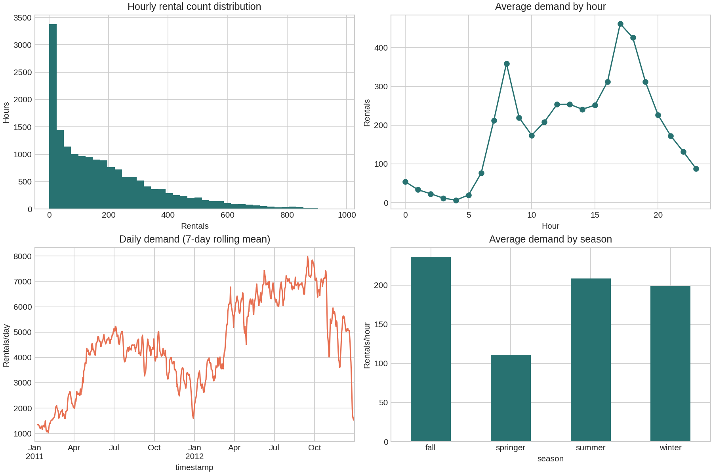

# Bike Rental Demand Forecasting 🚲

A machine learning project that estimates hourly bike-sharing demand using historical weather and calendar data. It helps operators anticipate busy hours, plan bike availability and reduce avoidable customer waiting time.



## Project overview

- 17,379 hourly observations covering 2011–2012; 17 original columns.
- Regression target: `cnt` (total rentals per hour).
- Five regression algorithms, a mean baseline, chronological validation and hyperparameter tuning.
- A saved preprocessing/model pipeline and interactive Streamlit dashboard for single-hour predictions, daily profiles and model evaluation.

## Repository structure

```text
bike-rental-demand/
├── app.py                        # Streamlit dashboard
├── eda.py                        # Data analysis and visualizations
├── train.py                      # Training, tuning and evaluation
├── src/features.py               # Cleaning and feature engineering
├── data/bike_rentals.csv          # Original supplied dataset
├── artifacts/
│   ├── model.joblib              # Selected trained pipeline
│   └── metadata.json             # Training and evaluation metadata
├── reports/
│   ├── eda_summary.json
│   ├── eda_overview.png
│   ├── correlation.png
│   ├── temperature_scatter.png
│   ├── model_comparison.csv
│   └── test_predictions.csv
├── tests/test_pipeline.py
├── requirements.txt
├── .streamlit/config.toml
└── .github/workflows/tests.yml
```

## Approach

1. **Data validation and EDA:** inspected types, missing values (including `?` placeholders), duplicates, demand distribution, daily patterns, seasonality, weather relationships, and correlations.
2. **Feature engineering:** derived date-related features, encoded categorical variables, added cyclical hour/month encodings and a rush-hour indicator, and standardized numeric inputs. Missing values are imputed using statistics learned within each training fold; deterministic calendar derivations are used where possible.
3. **Leakage prevention:** excluded `instant` (record identifier), `casual`, and `registered`. The latter two add up to the target and are not available for advance demand estimation. Recovered year, month and weekday from the date.
4. **Model selection:** held out the last 20% of calendar days. Compared a mean baseline, Ridge Regression, Decision Tree, Random Forest, Gradient Boosting and Histogram Gradient Boosting. Used three expanding-window CV folds with grid search on the training set. Selected the model with the lowest mean CV RMSE before inspecting the held-out test results.
5. **Evaluation and deployment:** compared MAE, MSE, RMSE and R² on the chronological test set. Saved the selected fitted pipeline and built a Streamlit dashboard.

Valid high-demand observations were retained rather than dropped as IQR outliers because the model needs to learn genuine peak rental periods. The original dataset is included unchanged.

## Results

Training set: **13,891 rows**. Chronological test set: **3,488 rows**, starting 2012-08-07.

| Model | CV RMSE ↓ | Test MAE ↓ | Test RMSE ↓ | Test R² ↑ |
|---|---:|---:|---:|---:|
| **Gradient Boosting (selected)** | **74.95** | 50.15 | 74.86 | 0.8847 |
| Histogram Gradient Boosting | 76.05 | 44.07 | 66.44 | 0.9092 |
| Random Forest | 83.53 | 52.33 | 78.57 | 0.8730 |
| Decision Tree | 89.28 | 52.67 | 80.12 | 0.8680 |
| Ridge Regression | 118.17 | 103.84 | 143.01 | 0.5793 |
| Mean baseline | 181.75 | 174.97 | 232.56 | -0.1124 |

Although Histogram Gradient Boosting has a lower test RMSE, Gradient Boosting is the selected model because it performed best on validation data. Switching winners based on the held-out test set would make the final evaluation less reliable. The selected model reduces test RMSE by approximately 68% relative to the mean baseline.

See [model comparison](reports/model_comparison.csv), [test predictions](reports/test_predictions.csv) and [model metadata](artifacts/metadata.json) for actual measured performance. CV RMSE is the selection criterion; the holdout metrics are descriptive and are not used to tune the model.

## Getting started

Use Python 3.12 and run these commands in the extracted project directory.

```bash
python -m venv .venv
```

Activate your virtual environment:

```powershell
# Windows PowerShell
.venv\Scripts\Activate.ps1
```

```bash
# macOS / Linux
source .venv/bin/activate
```

```bash
python -m pip install -r requirements.txt
python -m streamlit run app.py
```

The trained model and reports are already included; no retraining is required to run the dashboard. Only load bundled model artifacts that you trust, since serialized joblib files can execute code during loading.

### Reproduce results

```bash
python eda.py
python train.py
python -m pytest -q
```

The training script regenerates the selected model, metadata and evaluation reports. Hyperparameter search may take several minutes depending on hardware.

## Deployment on Streamlit Community Cloud

1. Create a GitHub repository and upload the contents of the project directory (including `artifacts`, `reports`, and `data`).
2. Open [Streamlit Community Cloud](https://share.streamlit.io/) and create an app from the repository.
3. Choose `main` as the branch, `app.py` as the entry point and Python 3.12 in advanced settings.
4. Deploy. No keys or credentials are required by the application.

## Business value and limitations

- Use predicted rental volume as one input into bike redistribution, staffing and maintenance planning.
- Rental counts measure observed demand, not unmet demand or the number of bikes required at individual stations. Operational inventory data would be needed to make allocation decisions.
- The data is historical and covers only 2011–2012. Predictions for later years and new cities are illustrative, not validated forecasts. The app uses manually entered weather scenarios rather than live weather forecasts.
- Normalized temperature and wind values must use the same scale as the supplied dataset. Heavy-rain cases are especially scarce (three rows); use caution when predicting these conditions.
- For real deployment, capture predictions and subsequent actual counts, monitor rolling MAE/RMSE and drift by hour/weather, and retrain on recent representative data when performance degrades. Validate a new model on a more recent untouched time window before replacing the production artifact.

## Data dictionary

| Field | Meaning |
|---|---|
| `dteday`, `hr` | Date (DD-MM-YYYY), hour (0–23) |
| `season`, `yr`, `mnth` | Dataset season, year and month |
| `holiday`, `weekday`, `workingday` | Holiday and calendar indicators |
| `weathersit` | Clear, Mist, Light Snow or Heavy Rain |
| `temp`, `atemp` | Normalized temperature and feels-like temperature |
| `hum`, `windspeed` | Normalized humidity and wind speed |
| `casual`, `registered` | Rental user counts (excluded from model) |
| `instant` | Row identifier (excluded from model) |
| `cnt` | Total hourly rentals (regression target) |

Data supplied as part of the Bike-Sharing Rental project. Confirm any redistribution rights before publishing the included dataset to a public repository.

## Technology stack

Python · pandas · NumPy · scikit-learn · Matplotlib · Streamlit · joblib · pytest · GitHub Actions
